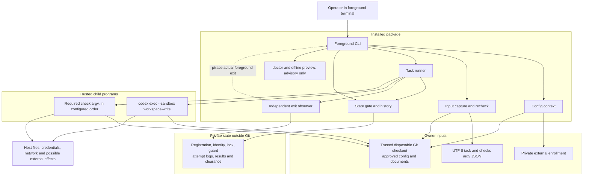
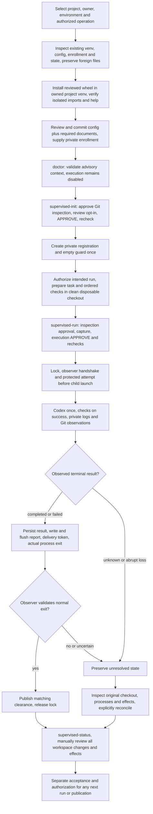
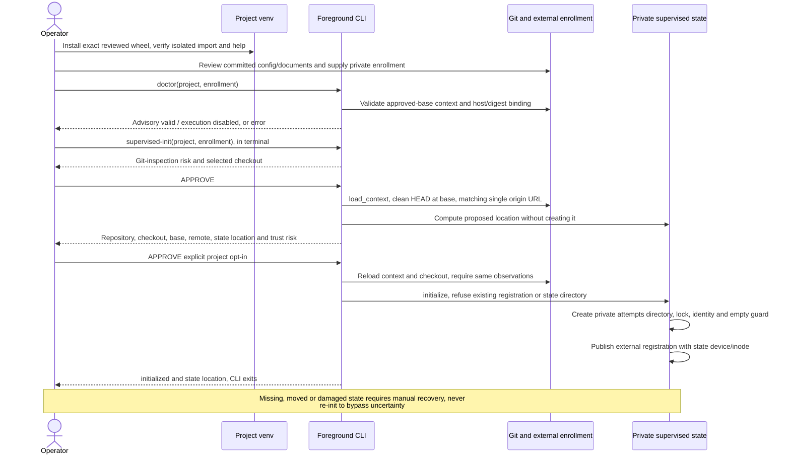
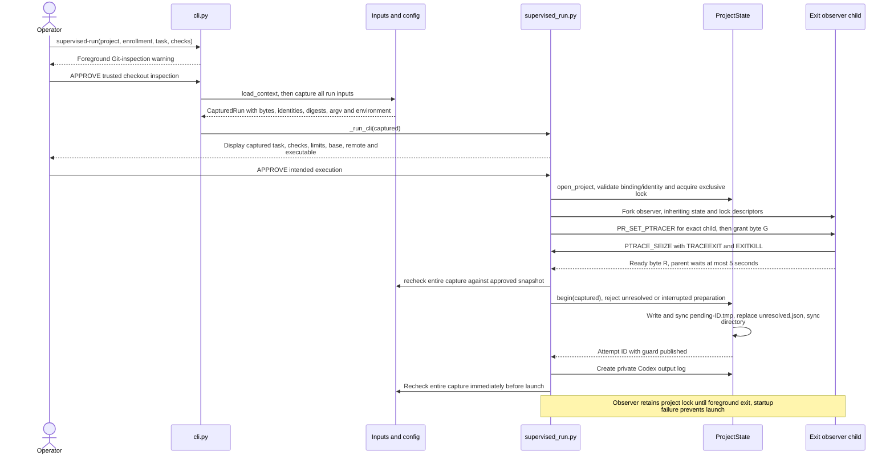
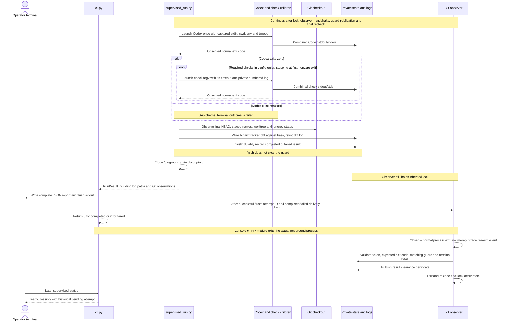
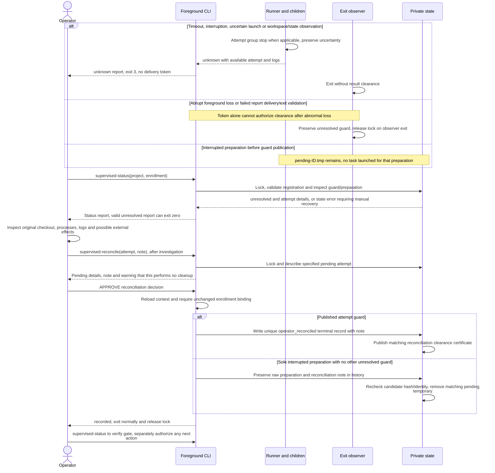
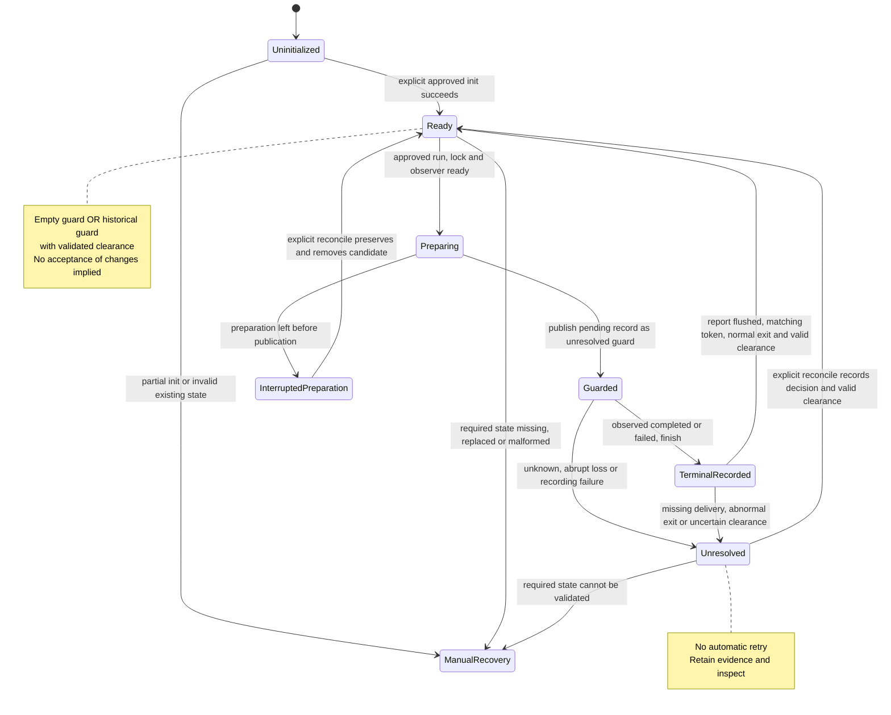

# Architecture and complete supervised lifecycle

This is the canonical architecture guide for the local `0.1.0.dev0` supervised
single-task release. It describes the implementation in `automation/`, traced
from the CLI through input capture, private state, execution, output and recovery.
The [owner guide](project-owner.md) owns installation commands and operating
instructions; the [release record](releases/2026-11-25-supervised-first-release.md)
owns qualification evidence and limits. Diagrams describe source behavior, not
proof of operational readiness on another project or host.

## Components and trust boundaries

The installed Python package uses the standard library and host Git. The
foreground CLI delegates one approved task to the selected Codex executable,
then invokes owner-configured checks. It does not select issues, create a
worktree, retry an attempt, or itself publish, push, merge or deploy. Child
programs remain trusted and can cause those effects themselves.

The boxes separate responsibilities and storage, not enforced containment.
Codex's requested sandbox is its own mechanism, not a runner guarantee. Project
Git inspection can run repository-configured filters; the CLI warns and asks for
approval before inspection for `supervised-init` and `supervised-run`. The
runner's Git helpers disable hooks, fsmonitor, global/system configuration and
remote transport, but that does not make hostile project code safe.

| Module / boundary | Responsibility and limit |
| --- | --- |
| [cli.py](../automation/cli.py) | Requires foreground stdin/stdout terminals for all supervised commands; displays approvals, writes the complete JSON report, flushes stdout, then notifies the observer only for `completed` or `failed`. Dedicated CLI process required; embedding is unsupported. |
| [config.py](../automation/config.py) | Reads private external enrollment and config/documents from its full approved Git commit. Checks repository, host, digest, document paths and approval/dependency schemas. It does not establish human authorship or grant execution authority. |
| [supervised_inputs.py](../automation/supervised_inputs.py) | Captures clean checkout/base/origin, task bytes, ordered check argv, limits, selected executable identity and allowed environment; repeats capture and compares after approval and immediately before launch. This is an observation/recheck, not immutable execution closure. |
| [supervised_run.py](../automation/supervised_run.py) | Opens state, starts the observer, publishes the attempt, runs Codex and checks, observes Git changes and records terminal results. Uncertain start/termination/observation retains the guard. |
| [supervised_state.py](../automation/supervised_state.py) | Validates registration and filesystem identity, takes a nonblocking exclusive lock, preserves attempts and validates clearance. Separate from the original native runtime Store. |
| [supervised_observer.py](../automation/supervised_observer.py) | Forks, attaches to the exact foreground PID, retains the lock and attempts clearance only after actual normal exit and matching delivery/result evidence. It never launches project work and does not contain descendants. |

## A to Z: owner journey

Use this route only after explicit authorization for the named project. The
release has live evidence from a synthetic fixture and one approved User Admin
task on Linux/WSL2. Other projects need their own opt-in and authorization.
Python >=3.12, Git, uv, the reviewed wheel, a foreground terminal, working local
filesystem primitives, Linux `/proc` and permitted ptrace are prerequisites.
Single-threaded execution and supported signal dispositions are required.

An attempt with a normal `failed` result can clear automatically just like a
`completed` one. That allows another authorized attempt; it does not accept the
changes. Abrupt runner loss remains UNKNOWN and requires explicit reconciliation.
The original autonomous runner, RNR-D00/G1–G6, its native exit-125 fence and five
open operational gates remain separate; see [scope below](#original-runtime-and-release-scope).

## Installation, enrollment and one-time opt-in

The owner installs a specific reviewed wheel into `.agent-runner/venv`, using
isolated imports rather than an editable checkout or `PYTHONPATH`. Preserve an
existing foreign venv. Config and required documents belong in the consumer's
Git history; venv, private logs and runtime state do not.

Enrollment is outside the project, owner-only, without symlink path components.
It binds repository, full approved revision, config SHA256 and host, plus the
validated approval/dependency data. `load_context` reads config and documents
from that commit, not from current working-tree files. The supervised task
approval is separate from the advisory issue-approval data. Initialization also
binds a digest of the complete validated context; an enrollment change is not
silently adopted by existing state.

Declining either approval returns without initialization. Invalid context or a
changed checkout fails. Partial initialization is not automatically reset. Use
the [owner guide](project-owner.md) for exact commands, schemas and permissions.

## Run capture, approval and protected admission

`capture` reads nonempty regular task/checks files, each at most 131072 bytes,
without following a final symlink. The task must decode as UTF-8; checks must be
operator-owned and not group/other writable. Required names must match config
exactly, and execution order follows `required_checks`. Arguments are bounded
argv arrays. Each timeout is an integer from 1 to 86400 seconds.

The captured checkout must be clean including untracked files and at the enrolled
base. Ignored files are observed and displayed, not excluded as a risk. Exactly
one `origin` URL must name the enrolled repository in the accepted GitHub HTTPS
or SSH form. That local label does not verify the remote server's identity.
The selected `codex` path and file stat identity are captured, not an independently
verified executable-content hash or full dependency closure.

Only present values of `PATH`, `HOME`, `CODEX_HOME`, `LANG`, `LC_ALL`, `TERM`,
`XDG_CONFIG_HOME`, `XDG_CACHE_HOME` and `TMPDIR` pass to children. Other variables,
including `OPENAI_API_KEY`, are not copied. CLI configuration and account files
may still expose credentials and influence execution; sign-in is not guaranteed.

Declined execution has no attempt. A failure before publishing an attempt does
not launch Codex. If preparation leaves `pending-ID.tmp`, it blocks later runs.
Once the guard is published, any unconfirmed path retains it. A known input
change at the last recheck is recorded as `failed` without launching Codex and
can follow normal report/exit clearance. Other state or observation errors after
an attempt ID exists return `unknown`.

The observer uses a separate session and closes unrelated inherited descriptors.
It watches the foreground process, not the Codex/check process tree. Its ptrace
`EXITKILL` option can kill the foreground process if the observer dies. It also
observes and reinjects delivered signals; it is an invasive Linux dependency.

## Task, ordered checks, report and actual exit

The runner invokes the selected executable as
`codex exec --sandbox workspace-write -C PROJECT -`, with captured task bytes on
an anonymous memory-backed stdin file. Each child has the selected checkout as
cwd, the explicit environment, a new session/process group and combined
stdout/stderr in its private log. Checks receive `/dev/null` stdin and use argv
without a shell wrapper; an owner-configured executable may itself be a shell.

The loop assumes observed normal child exits. Uncertain starts, negative exit
codes (signals), timeout or interruption take the UNKNOWN path below instead.
On timeout/interruption the runner attempts process-group SIGTERM, then SIGKILL
if needed. This does not prove escaped descendants or external effects stopped.
There is no automatic runner retry and no enforced spending cap; Codex may make
multiple provider/MCP connection attempts within its single invocation.

Final observation records HEAD change, staged changes, porcelain worktree status
and ignored status, and stores a binary tracked diff against the base. It is not
a complete archive of untracked/ignored content. Inspect the whole workspace and
actual changes manually. Child logs are closed after invocation; do not infer
power-loss durability of all child output from a terminal result record.

Only `completed` and `failed` reports notify the observer. Successful full-length
write plus flush means the operating system accepted output, not that a person
received or read it. The observer checks unchanged captured harmless-signal
dispositions at delivery; an unexpected delivered signal prevents automatic
clearance. A matching delivery token alone is insufficient: it also requires
actual normal exit (0 for `completed`, 2 for `failed`) and the matching stored
result. The pre-exit ptrace event alone does not satisfy this condition.

Automatic clearance is asynchronous. Immediate status may encounter the still
held lock and return an error; retry read-only status after the observer finishes.
Persistent lock or missing output requires investigation. A normal failed task
can clear, but a known result without confirmed report/exit remains unresolved.

## UNKNOWN, interrupted preparation and explicit reconciliation

Reconciliation records an operator decision. It neither stops processes nor
cleans the checkout, rolls back changes, proves absence of external effects, or
retries work. The attempt ID must match. A note is required and bounded to 4096
characters. The CLI holds the lock through inspection, approval and recording.
A refusal leaves state intact.

A single validatable interrupted preparation is recoverable through this path,
even if its captured record is incomplete; its raw bytes and digest are retained.
If another unresolved guard exists, reconcile that first. Multiple preparations,
missing/malformed required state or registration/identity replacement require
manual recovery rather than deleting files or running initialization again.
Failures during result, certificate or reconciliation recording must remain
uncertain until inspected; never infer clearance from an attempted write.

## State and status semantics

The diagram is a logical gate model, not a stored enum or a process-status API.
A project lock can temporarily prevent any status query. `unknown` is a run
outcome; `unresolved` describes the gate that blocks a subsequent attempt.

| Observable result | Meaning / exit behavior |
| --- | --- |
| `supervised-status`: `ready` | Valid empty guard, or a historical guard with valid matching result/reconciliation clearance. Historical `pending` may still be present. Exit 0 reports a successful status query only. |
| `supervised-status`: `unresolved` | Pending preparation, guard without clearance, or uncertain clearance. A valid report still exits 0; inspect its fields, not just the process code. |
| State unavailable/unsafe/locked or malformed required records | Error, ordinarily exit 2. No authority to reset state or start another attempt follows from this error. |
| Run `completed` | Codex and required checks observed successful, workspace observed and terminal result recorded. Exit 0; automatic clearance still depends on delivery and actual exit. Human acceptance remains separate. |
| Run `failed` | Observed normal nonzero command result, or known last-recheck input change before launch. Exit 2; eligible for normal-exit clearance. |
| Run `unknown` | Start, termination, state or observation uncertain. Exit 3, no automatic result clearance. Abrupt loss may provide no report at all. |
| Declined / command error | Generally exit 2; notification failure after report flush returns 3. Partial preparation or already-published guard can still require recovery. |

## Private storage lifecycle

The account home is resolved from the local account database, not redirected by
`HOME` or `XDG_STATE_HOME`. The root is
`~/.local/state/agent-runner/supervised-v1` under that account home. A SHA256 of
the lowercase repository name selects `KEY.json` and `KEY.state/`. Different
checkouts of the same repository/account share this gate; each attempt records
its original checkout. This does not isolate different users on the host or
permit enrollment reuse across projects.

| Location relative to that root | Creation and retained meaning |
| --- | --- |
| `KEY.json` | External registration, published during init, binding repository/context/state ID and state directory device/inode. |
| `KEY.state/identity.json` | Matching state identity and complete context binding; checked on every open. |
| `KEY.state/project.lock` | Exclusive nonblocking `flock`; inherited by observer. Concurrent run/status/reconcile can fail while held. |
| `KEY.state/unresolved.json` | Initially exact empty guard. `begin` atomically replaces it with the new attempt after writing/syncing a preparation. Logical clearance does not erase it. |
| `KEY.state/pending-ID.tmp` | Interrupted prepublication attempt preparation; blocks another begin and is preserved during explicit recovery. |
| `KEY.state/attempts/ID.codex.log`, `ID.check-NNNN.log`, `ID.diff.log` | Exclusively created output logs and tracked diff. Sensitive content stays private and outside Git. |
| `KEY.state/attempts/ID.json` | Stored `completed`/`failed` result with matching attempt inputs; alone does not clear the guard. |
| `KEY.state/clearance-ID-result.json` | Observer-published certificate binding the terminal record hash after validated delivery and normal exit. |
| `KEY.state/attempts/ID.reconciliation-*.json` and `clearance-ID-reconciliation-*.json` | Unique operator decision/note and corresponding clearance. |
| `KEY.state/attempts/ID.preparation-*.record` and `ID.preparation-reconciliation-*.json` | Raw interrupted preparation and recovery decision/digest retained before removing its temporary block. |
| `KEY.state/clearance-prepared-*.tmp` | Certificate staging file; not itself clearance. Interrupted publication requires inspection. |

Private state directories require mode 0700; state files require owner, mode 0600,
regular-file type and validated link count. Reads/writes use directory descriptors
and no-follow flags. New records use exclusive creation, file and directory
`fsync`; the guard uses atomic replace. Clearance writes/syncs a prepared
certificate, hard-links it to the final name, then removes the temporary name.
These are the implemented local-filesystem primitives, not a physical power-loss
proof. A clearance must validate against its terminal record, not merely exist.
Uncertain certificates remain blocking. See the release record for qualification
limits rather than assuming these primitives work on every filesystem.

A new attempt replaces only a logically clear guard, leaving prior logs, result
records and certificates in place. There is no automatic garbage collection,
retry, enrollment migration or state reset. Updating/uninstalling the package
retains private enrollment, attempts, logs and unresolved resources; downgrading
a wheel does not undo effects. Do not commit private state or evidence to Git.

## Original runtime and release scope

The [advisory contracts](automation.md) describe `doctor`, normalized offline
`preview`, selection and the original autonomous design. Valid advisory
configuration reports execution disabled. Live preview remains unavailable.
Those commands do not opt a project into supervised execution. The supervised
path does not enter the native Store, consume native runtime grants or activate
a service. It reuses validated context, not proof that the autonomous gates pass.

The retained native wrapper's unconditional abandon/exit-125 fence remains.
All five original gates are open: complete actual Codex profile and original
membership; real private qualification entry/session/command; whole independent
keeper/containment/recovery; immutable startup closure; actual integrated
success/failure/recovery qualification. RNR-D00/G1–G6 and historical evidence
remain in the [handoff](handoffs/2026-11-24-windows-visible-progress.md).
Production validation has never run. No diagram here authorizes service
activation, another provider call or a new project's opt-in.

## Documentation verification

This guide was traced against `cli.py`, `config.py`, `supervised_inputs.py`,
`supervised_run.py`, `supervised_state.py` and `supervised_observer.py` at the
implementation preserved in commit `a7c5077`, with checkpoint `a84b833` as the
documentation baseline. The trace covers setup, both approval boundaries,
rechecks, guard publication, observer handshake, child execution, result/report,
actual exit and recovery. No new implementation defect was established.

Rendering and link-check outcomes for this documentation change are recorded
in the [current handoff](handoffs/2026-11-24-windows-visible-progress.md). Prior
source/design review, tests and live fixture evidence remain in the release
record; documentation rendering is a separate check and does not repeat or
extend operational qualification.
